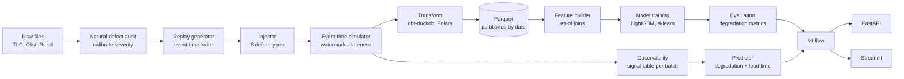
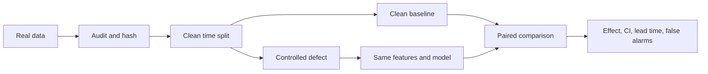

# Architecture

## 1. Design principles

1. **Simulator first.** The core experiments need deterministic event-time semantics, not a distributed cluster. Build a small simulator, validate it against Spark once, and keep the fast path for the full grid.
2. **Every component earns its place.** If a tool does not change a result or a deliverable, drop it.
3. **No cloud dependency.** A laptop runs the full study. A free VM is optional for the demo only.
4. **Reproducibility is a feature.** Config hashes, fixed seeds, recorded runs, one-command replay.
5. **The demo is part of the artifact.** A working dashboard is evidence that the harness is usable, not decoration.

## 2. Component map

| Layer | Tool | Why | Simpler alternative | Drop if |
|---|---|---|---|---|
| Data download | Python script plus manifest | Checksums and license tracking for three datasets | Manual download | Never |
| Natural-defect audit | Python checks | Calibrates severity against real defects | Manual EDA | Never |
| Replay | Python generator | Deterministic event-time order | Static CSV | Never |
| Event-time engine | Custom simulator, about 200 lines | Watermarks, lateness, windows | Spark from day one | Never |
| Fault injection | Python package | Config-driven, reversible, testable | Ad-hoc mutations in notebooks | Never |
| Transformation | dbt-duckdb plus Polars | SQL models, tests, resume value | Plain DuckDB SQL | Behind schedule |
| Storage | Parquet plus DuckDB | Cheap, portable, SQL-queryable | CSV | Never |
| Models | LightGBM plus scikit-learn | Strong tabular baseline | Linear only | Never |
| Tracking | MLflow | Run comparison and artifact logging | CSV logs | Behind schedule |
| Streaming validation | Spark Structured Streaming local (Redpanda optional) | Checks watermark and window semantics against a real engine | Simulator only | If week 8 slips |
| API | FastAPI | Demo endpoint | CLI | If week 9 slips |
| Dashboard | Streamlit | Fast interactive demo | Notebook | If week 9 slips |
| Packaging | Docker Compose | One-command demo | Virtualenv | Never |
| CI | GitHub Actions | Tests on every push | Local make | Never |
| Cloud | None, or a free-tier VM | Cost control | Laptop | Always |

## 3. Data flow



The same harness runs three tasks: TLC duration regression, Olist review classification, and Retail repeat-purchase classification. Each has its own fact table and dimension set, but the injector interface, observability schema, and evaluation code are shared. That is what makes cross-domain comparison possible without a synthetic control.

The injector sits between replay and the event-time engine so that defects can affect event arrival, not just table contents. A second injection point sits after transformation for schema and partition defects.

## 4. Module layout

```text
pipefault/
  __init__.py
  data/
    download.py        # URLs, SHA-256 manifest, license metadata
    audit.py           # natural-defect counts and severity calibration
    schema.py          # canonical schemas and type maps
    splits.py          # time splits and embargoes per dataset
  simulate/
    engine.py          # watermark, lateness, window assignment
    replay.py          # source replay in event-time order
  features/
    asof.py            # point-in-time joins
    build.py           # task-specific feature tables
  inject/
    base.py            # Injector protocol, InjectionResult
    fanout.py          # D1
    referential.py     # D2
    late_dimension.py  # D3
    watermark.py       # D4
    duplicate.py       # D5
    coercion.py        # D6
    partition.py       # D7
    timestamp.py       # D8
    registry.py        # name to injector
  observe/
    signals.py         # per-batch signal extraction
    drift.py           # PSI, KS
    confidence.py      # AC, ATC
  predict/
    dataset.py         # build training table from runs
    model.py           # LightGBM regressor, quantile variant
    baselines.py       # static thresholds, PSI-only, ATC
    evaluate.py        # MAE, R2, lead time, false-alarm rate
  api/
    main.py
  dashboard/
    app.py
dbt/
  models/
  tests/
configs/
  datasets/
  defects/
  experiments/
```

## 5. Interfaces

### Injector

```python
class Injector(Protocol):
    name: str

    def apply(
        self,
        tables: dict[str, DataFrame],
        severity: float,
        rng: np.random.Generator,
    ) -> InjectionResult:
        ...
```

`InjectionResult` carries the affected unit count, the affected row count, a metadata dict for the run record, and a reversible handle where possible. Injectors must be deterministic given a seed and must not mutate the input tables in place.

### Run config

```yaml
run_id: tlc_lightgbm_d1_s10_seed0
dataset: tlc
task: regression
target: duration_min
model: lightgbm
seed: 0
defects:
  - type: join_fanout
    severity: 0.10
    params:
      target: zone_daily_stats
split:
  train_end: 2024-06-30
  val_end: 2024-09-30
  test_start: 2024-10-02
```

The config is hashed and stored with the run. Two runs with the same hash and the same code commit must produce the same metrics within numerical tolerance.

### Observability row

One row per batch, versioned schema:

```text
batch_id, event_time_min, event_time_max,
row_count, row_count_delta, null_rate_max, distinct_ratio,
join_fanout_ratio, join_unmatched_rate, duplicate_rate,
asof_version_mismatch_rate, watermark_lag_p50, watermark_lag_p95,
late_event_count, schema_hash, schema_change_flag,
dbt_test_failures, psi_max, ks_max,
confidence_mean, confidence_std, atc_estimate,
...
```

Signal names and definitions are frozen before the full sweep. Adding a signal later is a documented deviation.

## 6. Failure handling

- **Missing partition:** the run fails fast with the partition ID and the expected path. No silent skip.
- **Raw hash mismatch:** abort the run before any feature build. A changed download is a different experiment.
- **Schema mismatch on load:** abort with a diff, unless the run is explicitly testing that defect.
- **Label-window overlap:** abort if the embargo does not cover the label horizon (1 day TLC, 7 days Olist, 90 days Retail).
- **NaN or infinite metric:** abort the run and log the condition. Do not impute model metrics.
- **Non-deterministic injector:** test failure. The unit test compares two runs with the same seed.
- **Simulator divergence:** if row-level agreement with Spark is below 99%, fail the validation gate and record it.

## 7. Security and trust boundaries

- No credentials in the repo. Data downloads use public URLs only.
- No PII processing. Olist review text is not used at all; only the numeric score. Customer and seller identifiers are dropped or hashed before modeling.
- The API is a demo, not a public service. Bind to localhost by default.
- Docker images use pinned versions. No `latest` tags in the demo.

## 8. Deployment

Local:

```bash
docker compose up --build
```

Services: `api` on port 8000, `dashboard` on port 8501, `mlflow` on port 5000. Optional `redpanda` profile for the streaming validation.

No cloud required. If a public demo is needed, deploy the dashboard to a free-tier VM or Hugging Face Spaces with aggregated data only. Do not redistribute Olist rows; the license is non-commercial and share-alike.

## 9. Performance targets

| Operation | Target |
|---|---|
| Clean baseline, 800k TLC rows, LightGBM | under 2 minutes |
| One injected condition, cached features | under 30 seconds |
| Primary grid, 1,332 runs, 4 workers | 4–8 hours |
| Full grid with MLP, 3,330 runs, 4 workers | 12–24 hours |
| Dashboard response | under 2 seconds |
| CI smoke test | under 5 minutes |

## 10. Architecture decision records

Record significant decisions in `docs/adr/` when they change the experiment plan. Examples: dropping Spark from the core path, changing the severity scale, replacing dbt with plain SQL.

## 11. Scientific-first implementation boundary

The core path is deliberately local and small:



Required for the first paper: Python, Polars or DuckDB, CPU LightGBM, local
artifacts, deterministic configs, and tests. Optional technologies must earn
their place by answering a research question. Spark is useful for validating a
small event-time subset; it is not required for the primary experiment.

On a 16 GB RAM machine, process monthly partitions and keep parallelism at one
or two workers. Do not load the full raw year and all experiment conditions into
memory at once. The RTX 4060 is optional because the planned tabular models are
CPU workloads; GPU training is deferred unless a measured experiment needs it.

The API, dashboard, Redpanda profile, MLP, and full-grid runner are downstream
artifact features. They must not delay the first complete result.
