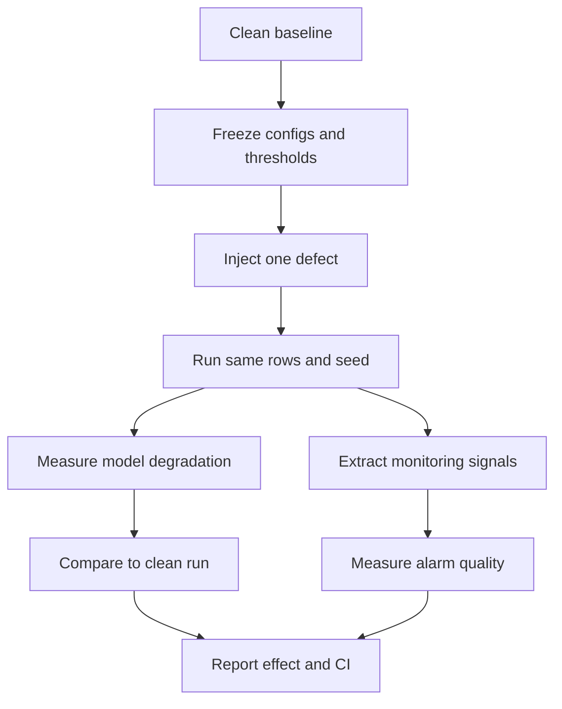

# Experiments

## 1. Grid

| Factor | Levels | Count |
|---|---|---|
| Datasets | TLC, Olist, Online Retail II | 3 |
| Model families | LightGBM, linear/logistic, MLP | 3 |
| Seeds | 0–4 | 5 |
| Clean baseline | 1 per combination | 1 |
| Single defects | 8 defects x 5 severities | 40 |
| Pairs | C(8,2) at 10% | 28 |
| Triples | 5 pre-selected at 10% | 5 |
| Conditions per combination | | 74 |
| Total runs | 3 x 3 x 5 x 74 | 3,330 |

The full grid is the journal tier. Run the staircase, not the full grid first.

| Tier | Datasets | Models | Seeds | Runs |
|---|---|---|---|---|
| Minimum publishable | TLC, Olist | LightGBM, linear/logistic | 3 | 888 |
| Primary | TLC, Olist, Retail | LightGBM, linear/logistic | 3 | 1,332 |
| Full | TLC, Olist, Retail | LightGBM, linear/logistic, MLP | 5 | 3,330 |

## 2. Defect mechanics

Severity is the fraction of the stated unit affected. Each injector reports the exact unit count and the realized fraction in the run record.

| ID | Defect | Injection recipe | Unit | Verification |
|---|---|---|---|---|
| D1 | Join fanout | Duplicate dimension rows for a fraction of keys: `zone_id` (TLC), `customer_id` (Olist), `stock_code` (Retail). Perturb a non-key attribute so the duplicate is not silently collapsed. | Dimension keys | Row count ratio matches severity within tolerance |
| D2 | Referential loss | Delete a fraction of dimension keys before the join, so an inner join drops facts. For TLC, delete zone rows; for Olist, delete customer rows; for Retail, delete product keys. | Dimension keys | Dropped fact count matches severity |
| D3 | As-of join bug | Join facts to `is_latest = true` instead of the version effective at the event time. This is a real feature-store bug, not a delayed update. | Facts | Version mismatch count matches severity |
| D4 | Watermark drop | Delay a fraction of events past the allowed lateness so the engine discards them. Only applies to the streaming replay path. | Events | Emitted event count matches severity |
| D5 | Duplicate ingestion | Replay a fraction of source events with new ingestion timestamps. At-least-once delivery makes this realistic. | Source events | Duplicate key count matches severity |
| D6 | Silent schema coercion | Cast a numeric column to string and back with truncation, or shift timezone/units for a fraction of values. Example: `passenger_count` loses non-integers; `UnitPrice` is divided by 100. | Values | Affected value count matches severity |
| D7 | Partial partition or stale backfill | Replace a fraction of date partitions with the previous day's snapshot. | Partitions | Partition hash differs for exactly the intended dates |
| D8 | Timestamp misalignment | Offset a fraction of event timestamps by 1–6 hours. | Events | Offset count and distribution match severity |

The injector is shared across datasets; only the target table and key change. Every injector must pass three tests: determinism with the same seed, exact affected-unit count, and reversibility where a reversible handle is supported. D4 is disabled for the batch-only replication; report that as a scope limit, not a failure.

## 3. Severity sweep

1%, 5%, 10%, 25%, 50%. The sweep produces a dose-response curve per defect. The 10% level is the reference for pairs and triples.

Before the sweep, run the natural-defect audit and record the baseline rate for each defect family. If the real data already has 8% duplicate rows, a 1% injection is not a treatment; start above the natural rate and record why. If a defect cannot be injected at 50% without breaking the pipeline structurally, cap it at the highest feasible level and record the deviation.

## 4. Splits and leakage prevention

| Dataset | Train | Validation | Test | Embargo | Label window |
|---|---|---|---|---|---|
| TLC | Jan–Jun 2024 | Jul–Sep 2024 | Oct–Dec 2024 | 1 day | Same trip |
| Olist | Sep 2016–Dec 2017 | Jan–May 2018 | Jun–Aug 2018 | 7 days | Review after order |
| Retail | Dec 2009–Sep 2010 | Jan–Mar 2011 | Apr–Sep 2011 | 90 days | 90-day repeat purchase |

- All joins are point-in-time. No dimension version later than the fact event time.
- Preprocessing, encoding, and imputation are fit on train only.
- TLC excludes `trip_distance`, `RatecodeID`, all fare fields, and dropoff time; the label is duration.
- Olist excludes actual delivery dates, review dates, and review text; the prediction point is order approval.
- Retail excludes every transaction after the invoice; the 90-day embargo covers the label window. Drop test invoices after 2011-09-09 or use a 60-day label for the final quarter and record the deviation.
- A future-blind test: shuffle future rows and confirm that test metrics do not change.
- A leakage checklist based on Kapoor & Narayanan's taxonomy is part of CI.

## 5. Baselines

| Baseline | Description |
|---|---|
| Clean | Model trained and evaluated on clean data |
| Single-defect | Model trained clean, evaluated on one defect |
| PSI | Alarm when any feature PSI exceeds a threshold |
| KS | Alarm when any feature KS statistic exceeds a threshold |
| AC | Average confidence drop |
| ATC | Average Thresholded Confidence, Garg et al., ICLR 2022. Classification datasets only. |
| Regression confidence proxy | Ensemble or quantile spread for TLC; secondary comparison, not a headline |
| Static thresholds | Row count ±20%, null rate >5%, schema hash change |
| Oracle | Knows the injected defect and severity |

Thresholds for PSI, KS, and static rules are tuned on a validation slice of clean runs and frozen before the test runs. ATC is implemented from `https://github.com/saurabhgarg1996/ATC_code`: choose the threshold on clean validation so the fraction of validation confidences above it equals clean accuracy, then apply that threshold to the target batch. Convert ATC and AC accuracy estimates to relative degradation with `(M_clean - M_hat) / M_clean` so they are comparable with the observed degradation. This conversion is part of the baseline, not a post-hoc adjustment.

## 6. Metrics

- **Relative degradation:** `(M_defect - M_clean) / M_clean`. M is RMSE for TLC regression, and error rate `1 - F1` for Olist and Retail classification. Positive means worse.
- **Interaction index, primary:** `D_AB - D_A - D_B` (RERI). Positive means super-additive. Report the multiplicative form `D_AB - D_A - D_B - D_A D_B` as a sensitivity check.
- **Prediction MAE and R2:** predicted versus observed relative degradation on held-out conditions.
- **Lead time:** number of batches between the first warning and the batch where degradation crosses the damage threshold (10% relative).
- **False-alarm rate:** false warnings per clean batch at a fixed recall of 0.8.
- **Detection delay:** batches between injection and first alarm.
- **Cost-weighted regret:** degradation times batch cost, with and without warning.

## 7. Statistics

- Paired bootstrap with 10,000 resamples for all confidence intervals.
- Mixed-effects model: fixed effects for dataset, model family, defect family, and severity; random intercept for seed.
- Benjamini-Hochberg FDR for exploratory families; Holm-Bonferroni for the four pre-registered hypotheses.
- Report mean, standard deviation, and 95% CI for every headline number.
- Minimum three seeds for the primary tier; five for the full tier. No optional stopping.
- Mixed-effects model includes a dataset × defect interaction term; if it is significant, do not pool the datasets without reporting it.

## 8. Ablations

| Ablation | Question |
|---|---|
| Signal families | Which of volume, schema, freshness, distribution, confidence carries the signal? |
| Operator-aware vs generic | Do join-fanout ratio and watermark lag add value over PSI/KS? |
| Predictor type | Is LightGBM better than linear or MLP on this feature set? |
| Leave-one-defect-out | Does the predictor generalize to an unseen defect? |
| Leave-one-dataset-out | Does it generalize across domains? |
| Severity interpolation | Can it predict 25% from training on 1, 5, 10, 50%? |
| Event-time features | Do watermark features matter, or do row counts suffice? |
| Join topology | Does the star schema (TLC) interact differently from the multi-hop schema (Olist)? |
| Natural-defect baseline | Do results change if runs with high natural-defect rates are excluded? |

## 9. Run management

- Every run has a config hash, a code commit, a seed, and an MLflow run ID.
- Artifacts: metrics JSON, predictions parquet, signal table parquet, injector metadata JSON.
- Feature tables are cached per dataset and split; only the injection and model fit rerun per condition.
- `make experiment` runs the grid with a worker pool and resumes from completed run IDs.
- `make reproduce RUN_ID=...` re-executes one run and compares metrics.
- Results are never edited by hand. Figures are generated from the run table.

## 10. Runtime budget

| Workload | Estimate |
|---|---|
| One LightGBM condition, 100k rows, cached features | 10–30 seconds |
| One MLP condition, 100k rows | 1–3 minutes |
| Primary tier, 1,332 runs, 4 workers | 4–8 hours |
| Full tier with MLP, 3,330 runs, 4 workers | 12–24 hours |
| TLC pilot, 40 conditions | under 30 minutes |
| Simulator vs Spark validation, 3 conditions | under 2 hours |

## 11. Result tables to produce

- **R0:** Natural-defect audit per dataset, with the injection levels that exceed the natural rate.
- **R1:** Clean baseline performance per dataset and model.
- **R2:** Single-defect dose-response, mean and CI per defect and severity.
- **R3:** Pairwise interaction index, heatmap, and count of significant pairs.
- **R4:** Early-warning comparison: MAE, R2, lead time, false-alarm rate per baseline.
- **R5:** Ablations by signal family and feature type.

## 12. Threats to validity

- **Construct:** injected defects may not match real production defects. Mitigate with mechanics derived from operator semantics, a taxonomy review, and the natural-defect audit that calibrates severity to defects already present in the data.
- **External:** three real domains with different schemas and tasks. Do not claim universal coverage; report domain-specific effects.
- **Internal:** seeds and splits are fixed; injector determinism is tested.
- **Conclusion:** multiple comparisons are corrected; all conditions are reported, including nulls.
- **Simulator fidelity:** validated against Spark on a subset; divergence is reported, not hidden.

## 13. Minimum publishable experiment

The first complete study is intentionally smaller than the full grid:

- Dataset: TLC only.
- Defects: D1 join fanout, D2 referential loss, D3 as-of join bug, and D4
	watermark drop.
- Severity: 1%, 5%, 10%, 25%, and 50%, unless natural defect rates require a
	documented adjustment.
- Models: LightGBM and one simple linear or logistic baseline as applicable.
- Seeds: at least 3.
- Controls: clean paired runs, ordinary seasonal changes, and at least one
	defect that should not materially change the target metric.
- Outputs: degradation curves, confidence intervals, detection delay, lead
	time, false-alarm rate, and exact affected-unit counts.

Do not begin the full 3,330-run grid until this pilot passes the determinism,
leakage, and interpretability gates. A null result is publishable when the
design can show that the defect was injected correctly and the confidence
interval excludes a practically meaningful effect.

## 14. Negative controls and fairness of comparison

The experiment must include clean batches with legitimate seasonal or volume
changes. These are negative controls for false alarms. Defect and clean runs
must share the same sampled records, split, model configuration, and seed; only
the declared treatment may differ. Thresholds are chosen on clean validation
runs and frozen before test evaluation.
