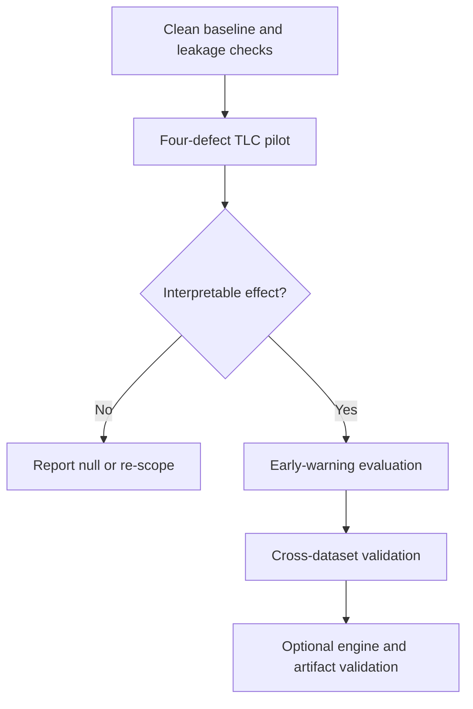

# Pre-registration

Commit this file before the full experiment sweep. Record every deviation in the log at the bottom. The point is to prevent hypothesizing after the results are known.

- Project: PipeFault
- Author: _fill in_
- Date: _fill in_
- Commit hash at freeze: _fill in_

## 1. Research questions

- **RQ1:** Which operator-level defects cause the largest model degradation per unit of affected data, and which are invisible to standard drift monitors?
- **RQ2:** Do co-occurring defects interact super-additively, and does the interaction depend on shared pipeline paths?
- **RQ3:** Can observability metadata predict degradation before labels arrive, and how much lead time does it buy over ATC and static thresholds?
- **RQ4:** Which signal families drive predictive power?
- **RQ5:** Can a low-dimensional corruption vector, defined on model outputs, feature distributions, and coverage, predict both degradation and detectability across defect types and domains?

## 2. Hypotheses and falsification criteria

| ID | Hypothesis | Falsified if |
|---|---|---|
| H1 | Value-corrupting silent defects (late-arriving dimension, silent type coercion, timestamp misalignment) produce at least 2x the degradation of volume-based defects at matched nominal severity | Median relative degradation ratio is below 2x, or drift-monitor alarm recall on silent defects is at least 50% |
| H2 | Defects on shared paths have a positive additive interaction (RERI > 0) | Median RERI is at most zero, or 95% CI includes zero for more than 70% of pairs |
| H3 | On the two classification datasets, operator-aware observability features reduce degradation-prediction MAE by at least 20% versus ATC on silent defects, with median lead time of at least one batch. TLC is a secondary regression check using a confidence-spread proxy | MAE reduction is below 20% on both classification datasets, or lead time is below one batch on both |
| H4 | Detection latency explains more variance in cost than detection accuracy | Latency coefficient is not significant in the mixed-effects model |
| H5 | A model using only the corruption vector (alpha, beta, gamma) predicts relative degradation on held-out defects with at least 10% lower MAE than a per-defect lookup table, and transfers to a held-out dataset with R2 at least 0.5 | It fails to beat the lookup table, or adding defect or dataset identity lowers MAE by more than 10%, or transfer R2 is below 0.3 |
| H6 | The silence index `s = alpha / (alpha + beta + gamma)` ranks conditions by alarm recall and lead time, and alpha-dominant defects have recall below 50% at the frozen false-alarm rate | Spearman correlation below 0.3, or AUC below 0.7, or alpha-dominant recall within 10 points of beta/gamma-dominant recall at matched severity |

Silent value-corrupting defects are D3, D6, and D8. Volume defects are D1, D2, D4, and D5. D7 is a mixed missing/stale defect and is analyzed separately, not in the H1 contrast. The split is fixed before the sweep.

Severity is nominal and unit-specific: 10% of dimension keys is not the same number of affected rows as 10% of events. H1 compares defects at matched nominal severity, and every result table reports the affected-row count alongside the severity label.

Report the result even when a hypothesis is falsified. A null result is a valid outcome.

## 3. Defect taxonomy

Severity is the fraction of the relevant unit affected. The unit differs by defect and is stated below. Every defect is applied to real records from the three datasets in `docs/DATASETS.md`; no synthetic rows are generated. The clean run is the reference.

| ID | Defect | Operator | Severity unit | Expected symptom |
|---|---|---|---|---|
| D1 | Join fanout | Fact-dimension join | Fraction of dimension keys duplicated | Row count inflation |
| D2 | Referential loss | Inner join | Fraction of dimension keys removed or mutated | Row count deflation |
| D3 | Late-arriving dimension | As-of / SCD join | Fraction of facts joined to the wrong version | Feature staleness or future leakage |
| D4 | Watermark drop | Event-time watermark | Fraction of events arriving after the watermark | Silent event loss |
| D5 | Duplicate ingestion | Source ingestion | Fraction of source events replayed | Duplicate rows |
| D6 | Silent schema coercion | Cast / normalization | Fraction of values affected | Type drift, truncation, timezone or unit shift |
| D7 | Partial partition or stale backfill | Partition load | Fraction of partitions replaced with the previous snapshot | Missing or stale data |
| D8 | Timestamp misalignment | Event-time assignment | Fraction of timestamps offset by 1 to 6 hours | Window and join misalignment |

### Corruption-space annotation

Every condition is annotated after the paired clean and defect runs complete, on the same rows. The annotation tests H5 and H6; it is not a treatment and does not change the run.

| Component | Symbol | Definition | Computed from |
|---|---|---|---|
| Decision displacement | alpha | Fraction of matched rows present in both runs with `abs(yhat_defect - yhat_clean) > tau_pred`, where `tau_pred = 0.1 x SD(yhat_clean)` | Paired clean and defect predictions |
| Distribution displacement | beta | Maximum over monitored features and monitor families of `min(1, statistic / frozen_threshold)`, using PSI and KS | Feature table and frozen monitor thresholds |
| Coverage displacement | gamma | `min(1, abs(N_defect - N_clean) / N_clean)` | Row counts |

Silence index: `s = alpha / (alpha + beta + gamma + epsilon)`, clipped to `[0, 1]`.

Rules:

- Alpha is computed only on rows present in both runs. Rows removed or added are captured by gamma, not alpha.
- For classification tasks, `yhat` is the positive-class probability.
- `tau_pred` and the monitor thresholds are frozen on clean validation data before any test condition is annotated.
- Alpha is an oracle quantity. It is used to test the law, not as a deployable signal. The predictor experiments estimate it separately from metadata and confidence.
- Report alpha, beta, gamma, and `s` in every run record. A missing annotation is an incomplete run.

### Metadata-borne track (optional, post-pilot)

A separate track for defects visible only through freshness, lineage, or provenance metadata, not through payload values (SARC-DQ style). Examples: stale dimension row superseded but not removed, backfill that rewrites history, lineage gap. This track is analyzed separately and does not enter the H1 silent-vs-volume contrast. Add only after the eight-defect pilot is interpretable.

## 4. Conditions

- **Clean baseline:** 1 condition per dataset and model.
- **Single defects:** 8 defects x 5 severities (1%, 5%, 10%, 25%, 50%) = 40 conditions.
- **Pairs:** all 28 pairs at 10% severity.
- **Triples:** 5 pre-selected triples at 10% severity.
- **Total per dataset, model, seed:** 74 conditions.

Each condition is annotated with alpha, beta, gamma, and the silence index `s` before analysis. Annotation follows the corruption-space subsection in section 3 and is recorded with the run.

Pre-selected triples: (D1, D3, D5), (D2, D4, D7), (D1, D6, D8), (D2, D3, D8), (D4, D5, D6). All eight defects appear at least once; D7 appears once because partition defects are the most expensive to inject.

### Tier choice (record before sweep)

Minimum publishable (TLC, Olist; LightGBM, linear/logistic; 3 seeds; 888 runs) is the default. Primary and full tiers are recorded here before the sweep and are not upgraded after results are seen.

### Grid staircase

| Tier | Datasets | Model families | Seeds | Runs | Purpose |
|---|---|---|---|---|---|
| Minimum publishable | TLC, Olist | LightGBM, linear/logistic | 3 | 888 | Enough for a workshop paper |
| Primary | TLC, Olist, Retail | LightGBM, linear/logistic | 3 | 1,332 | Main results |
| Full | TLC, Olist, Retail | LightGBM, linear/logistic, MLP | 5 | 3,330 | Journal robustness |

The tier is chosen before the sweep and recorded. Do not run the full grid first. The week-3 pilot uses a 40-condition subset on TLC.

### Severity calibration

Before the sweep, measure the natural defect rate in each dataset for each defect family. If a natural rate is already above the lowest injected severity, start the sweep above it and record why. This prevents claiming that a 1% injection is meaningful when the raw data already has 8% duplicates.

## 5. Datasets

| Dataset | Role | Task | Target | License |
|---|---|---|---|---|
| NYC TLC yellow taxi, 2024 | Primary; large, event-time | ETA regression | Trip duration (min) | NYC Terms of Use |
| Olist Brazilian e-commerce | Multi-table joins | Review classification | `review_score >= 4` | CC BY-NC-SA 4.0 |
| UCI Online Retail II | Long horizon, repeat purchase | Repeat-purchase classification | Purchase within 90 days | CC BY 4.0 |

All three are real public datasets. Exact sources, schemas, splits, and leakage exclusions are in `docs/DATASETS.md`. Fixed sample sizes and date ranges are recorded in `configs/datasets/` and hashed into each run.

## 6. Models

- LightGBM (primary).
- Logistic or linear regression (simple baseline).
- Small MLP, 2 hidden layers (full-grid sensitivity check only).

Hyperparameters are fixed before the sweep and recorded in config. No per-condition tuning. The minimum and primary tiers use two model families; the MLP is added only in the full tier.

## 7. Metrics

| Metric | Definition | Direction |
|---|---|---|
| Relative degradation | `(M_defect - M_clean) / M_clean` | Higher is worse |
| Interaction index, primary | `D_AB - D_A - D_B` (RERI) | Positive is super-additive |
| Interaction index, multiplicative | `D_AB - D_A - D_B - D_A D_B` | Positive is super-additive |
| Prediction MAE | Mean absolute error of predicted relative degradation | Lower is better |
| Prediction R2 | Coefficient of determination on held-out conditions | Higher is better |
| Lead time | Batches between warning and the damage threshold | Higher is better |
| False-alarm rate | False warnings per clean batch at fixed recall | Lower is better |
| Detection delay | Batches between injection and first alarm | Lower is better |
| Decision displacement | alpha, section 3 | Higher means more hidden damage |
| Distribution displacement | beta, section 3 | Higher means more visible to drift monitors |
| Coverage displacement | gamma, section 3 | Higher means more visible to volume checks |
| Silence index | `s = alpha / (alpha + beta + gamma)` | Higher means less detectable |
| Law prediction error | MAE and R2 of predicted versus observed relative degradation on held-out conditions | Lower MAE, higher R2 |
| Law transfer gap | MAE on held-out dataset minus MAE on the fit dataset | Lower is better |

The additive RERI is primary because relative degradation is a ratio, not a probability. Report the multiplicative form as a sensitivity check, not as the headline.

## 8. Statistical analysis

- Paired bootstrap, 10,000 resamples, 95% percentile intervals.
- Mixed-effects model with dataset, model family, defect type, and severity as fixed effects and seed as a random intercept. Three datasets and three model families are too few for reliable random effects.
- Benjamini-Hochberg FDR for exploratory families; Holm-Bonferroni for the six pre-registered hypotheses.
- Three seeds for the minimum and primary tiers; five for the full tier. Report mean and standard deviation.
- No optional stopping after the tier is chosen. Run the chosen tier to completion.

### Law evaluation protocol

- **Primary comparison:** corruption-only model (alpha, beta, gamma) versus a per-defect lookup table, evaluated by leave-one-defect-out on TLC.
- **Secondary comparison:** corruption plus defect identity, and corruption plus dataset identity. If identity lowers MAE by more than 10%, the law is incomplete and the paper reports that.
- **Transfer:** fit on TLC, evaluate on Olist and Retail without refitting. Report R2 and the MAE gap.
- **Detectability:** rank conditions by the silence index and test the monotone association with alarm recall and lead time using Spearman correlation and ROC AUC.
- **Uncertainty:** paired bootstrap over conditions, 10,000 resamples.
- No feature selection on test conditions. Alpha, beta, and gamma are fixed by section 3 and are not tuned per dataset.
- Report all three models in the same table, including the lookup table.

## 9. Stopping and re-scoping rules

- If the week-3 TLC pilot shows less than 2% median relative degradation for more than half of the single-defect conditions, stop the full sweep and re-scope.
- Re-scoping options: reframe as a negative-result measurement paper, drop to the minimum grid, or switch to the SchemaMiner backup.
- If the cross-dataset week-4 check shows the same defect has opposite-signed effects on two datasets, report it as a domain-dependence finding and do not pool the datasets without an interaction term.
- If the simulator-versus-Spark agreement is below 99% at the row level, drop the streaming claim and report the harness as a micro-batch event-time simulator.
- If H5 fails on TLC, keep the measurement study and drop the law claim. Do not add predictors, interactions, or new features until it passes; that is p-hacking.
- If H6 fails, report detectability as defect-specific and drop the silence index from the headline.

## 10. Deviations log

## 11. Scientific-first execution policy

The order of work is fixed by evidential value:

1. Verify the clean baseline and leakage checks.
2. Implement and test four defects: D1, D2, D3, and D4.
3. Complete the TLC pilot with paired clean controls.
4. Freeze thresholds and evaluate early-warning metrics.
5. Add D5-D8 only after the pilot is interpretable.
6. Add Olist and Retail for cross-domain validation.
7. Add Spark validation, a dashboard, or additional models only when they
   support an explicit result.

The project will not use additional infrastructure as a proxy for scientific
progress. Every extension must identify its research question, expected
observable output, and a kill criterion before implementation.

| Date | Deviation | Reason | Impact on hypotheses |
|---|---|---|---|
| | | | |
