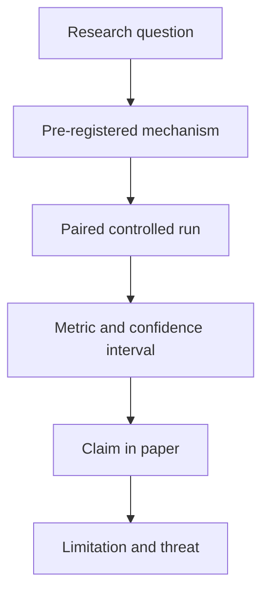

# Publication strategy

Dates change. Verify every deadline on the official call for papers before planning around it. The dates below were checked in October 2026.

## 0. Working title and abstract

**Title:** PipeFault: A Corruption-Space Law for Damage and Detectability of Operator-Level Data Defects in ML Pipelines

**Alternative:** When Data Pipelines Fail Silently: Measuring Compounding Operator Defects and Predicting Which Ones Stay Invisible

**Abstract draft:**

> Production ML pipelines often fail without an error. A join fans out, a dimension arrives late, a watermark drops events, or a schema change coerces a type. The job succeeds and model quality degrades silently. Existing studies inject data-quality defects into static tables, but they do not model pipeline operators, event time, compounding defects, or the delay before labels reveal damage. We present PipeFault, a reproducible fault-injection harness for streaming ML pipelines, and a controlled study on three real public datasets: NYC taxi trips, Olist e-commerce orders, and UCI Online Retail II. We represent every defect by three measurable displacements: decision displacement (alpha), distribution displacement (beta), and coverage displacement (gamma). We test two claims. First, relative degradation is a low-dimensional function of this corruption vector, and a model fitted on one domain predicts held-out defects and datasets better than a per-defect lookup table. Second, standard monitors observe beta and gamma but not alpha, so the silence index alpha/(alpha+beta+gamma) predicts alarm recall and lead time, and alpha-dominant defects can stay invisible until labels arrive. We report effect sizes, interaction indices, transfer error, lead time, and false-alarm rates, including negative results. Code, configs, and run artifacts are released for reproduction.

## 1. Target venues

| Venue | Type | Expected deadline | Indexing | Cost | Fit | Risk |
|---|---|---|---|---|---|---|
| DEEM 2027, workshop at SIGMOD/PODS | Workshop | ~March 2027 (DEEM 2026 submissions were March 2026; workshop 5 June 2026) | ACM DL, not Scopus | Registration fee; verify | Excellent milestone: data management for end-to-end ML | Workshop, not indexed |
| IEEE DSAA 2027 | Conference | ~May 2027 (DSAA 2026 was 6–9 Oct, New Delhi) | IEEE, Scopus | Registration | Good | Call not published as of Oct 2026 |
| IEEE BigData 2027 | Conference | ~August 2027 (2026 deadline was 21 Aug) | IEEE, Scopus | Full registration for accepted papers, not student rate | Good | 18% acceptance in 2025 |
| NeurIPS Datasets and Benchmarks 2027 | Benchmark track | ~May 2027 abstract, ~June 2027 full; verify | NeurIPS proceedings, no APC | Free to submit; registration if accepted | Stretch: benchmark plus a law | High; needs breadth and evidence of use |
| SIGMOD 2028 / PVLDB / ICDE 2028 | Main conference | SIGMOD and ICDE ~Oct–Nov 2027; PVLDB monthly rounds | ACM/IEEE DL, Scopus | Registration | Stretch: law plus artifact | High; top-tier acceptance |
| ACM JDIQ | Journal | Rolling | Scopus | APC US$1,450 no member / US$950 member; lower-middle-income US$725 / US$475 | Excellent: empirical data quality | Slow review |
| IEEE Access | Journal | Rolling | SCIE/Scopus | APC US$2,160 plus taxes | Fallback | Cost |
| MSR 2028 | Conference | ~October 2027 | ACM, Scopus | Registration | Only for the SchemaMiner backup | Wrong cycle for this project |

Recommended sequence: **milestone first, stretch second.**

1. **Milestone:** DEEM 2027 with the measurement study (888-run minimum tier). This is a real, low-risk publication and a deadline that forces the pilot to finish.
2. **Stretch:** if the damage law collapses and transfers (see `docs/PREREGISTRATION.md`, H5–H6), extend to SIGMOD/VLDB/ICDE 2028 or NeurIPS Datasets and Benchmarks 2027. The law is what makes the paper top-tier; without it, stay at the workshop and journal track.
3. **Journal:** JDIQ extension only if funded. Do not pay for IEEE Access unless funding exists and a fast journal line is required.

## 2. Paper structure

1. **Introduction.** Silent pipeline defects, Data Cascades, observability gap, contributions.
2. **Related work.** DQ to ML, drift, freshness, pipeline debugging, label-free estimation.
3. **Taxonomy and threat model.** Eight defects, operator mapping, severity definition.
4. **Corruption space.** Operational definition of alpha, beta, gamma; annotation protocol; why defect identity should not be needed.
5. **Damage and detectability laws.** Hypotheses, fitting procedure, falsification criteria, transfer protocol, lookup-table baseline.
6. **PipeFault harness.** Injector, event-time simulator, observability signals, reproducibility.
7. **Experimental setup.** Datasets, models, conditions, metrics, statistics.
8. **Results.** R1 clean baseline, R2 dose-response, R3 interactions, R4 early-warning baselines, R5 ablations, R6 law fit and transfer, R7 detectability and lead time.
9. **Discussion.** Implications for data engineers; when observability fails; blind spots.
10. **Threats to validity.**
11. **Conclusion.**
12. **Artifact appendix.** DOI, commands, hardware, runtime.

Target length: 8–10 pages for DEEM or DSAA, 10 pages for BigData, journal length for JDIQ.

## 3. Figures and tables

| Item | Content | Claim it supports |
|---|---|---|
| Fig. 1 | Architecture | The harness is a real system |
| Fig. 2 | Taxonomy diagram with corruption annotations | Defects map to operators and to alpha/beta/gamma |
| Fig. 3 | Dose-response curves | RQ1, H1 |
| Fig. 4 | Corruption-space collapse: observed versus predicted degradation, all defects and datasets | H5, the damage law |
| Fig. 5 | Silence index versus alarm recall and lead time | H6, the detectability law |
| Fig. 6 | Interaction heatmap | RQ2, H2 |
| Fig. 7 | Lead-time versus false-alarm tradeoff | RQ3, H3 |
| Table 1 | Related-work comparison | Novelty positioning |
| Table 2 | Datasets, tasks, licenses, splits | Reproducibility |
| Table 2b | Natural-defect audit and calibrated severity | Construct validity |
| Table 3 | Single-defect results with alpha/beta/gamma | RQ1 |
| Table 4 | Compounding results | RQ2 |
| Table 5 | Law fit, transfer error, lookup-table comparison | H5 |
| Table 6 | Detectability: recall, lead time, false alarms by silence index | H6, RQ3 |
| Table 7 | Ablations | RQ4 |
| Table 8 | Compute and runtime | Reproducibility |

## 4. Related-work positioning

| Work | Claim | Limitation | This project |
|---|---|---|---|
| Mohammed et al. 2025 | DQ dimensions degrade ML | Dataset-level, static, single defects | Operator-level, streaming, compounding, lead time |
| Dapaah & Grabowski 2025 | DQ issues co-occur | Software defect prediction only | General pipelines plus observability |
| Shankar & Parameswaran 2022 | Observability needs detect/diagnose/react | Vision, no benchmark | Controlled benchmark |
| FIUL-Data, ECBS 2023 | Fault injection tests ML resilience | One fault at a time, no lead time | All-pairs compounding plus early warning |
| dpEmu, ISSREW 2019 | Data fault emulation for ML systems | Single faults, no lead time | Compounding plus observability |
| RALF 2024 | Freshness affects accuracy | Freshness only | Broader operator taxonomy |
| Garg et al., ICLR 2022 | ATC predicts OOD accuracy | No pipeline metadata | Operator-aware features versus ATC |
| Karlaš et al., SIGMOD Companion 2025 | Data errors propagate across pipeline stages | Tutorial, no controlled benchmark | Controlled benchmark with lead time |

## 5. Claims checklist

Do not write a claim until the corresponding evidence exists.

- [ ] H1 supported by dose-response across at least two datasets and three seeds.
- [ ] Silent defects shown to evade PSI/KS at a stated threshold and recall.
- [ ] H2 supported by additive RERI with 95% CI, plus multi-way decomposition for triples, or reported as a null.
- [ ] H3 supported by MAE reduction on at least one classification dataset and lead time at a fixed false-alarm rate.
- [ ] H4 supported by a significant detection-latency coefficient in the cost mixed-effects model.
- [ ] **L1 (collapse):** the (alpha, beta, gamma)-only model explains a pre-registered share of variance in relative degradation on held-out seeds.
- [ ] **L2 (transfer):** a model fitted on TLC predicts Olist and Retail, and beats both a per-defect lookup table and a model given defect identity. Report the gap; if defect identity helps, say the law is incomplete.
- [ ] **L3 (leave-one-defect-out):** the law predicts a defect family it never saw.
- [ ] **L4 (detectability):** the silence index is positively associated with alarm recall and lead time, with a pre-registered AUC, and alpha-dominant defects stay below the stated recall at frozen thresholds.
- [ ] **Negative result on record:** if L1-L4 fail, the paper reports the failure with the same detail as a positive result.
- [ ] Early-warning panel (ATC/AC/DoC/MCD + PSI/KS) ablated by signal family.
- [ ] Metadata-borne track reported separately if implemented.
- [ ] Simulator validated against Spark, or the streaming claim removed.
## 6. Evidence-first paper boundary

The paper should make a claim that the experiments can support:

> Under controlled real-record treatments, operator-level defects can be
> represented by a small corruption vector (alpha, beta, gamma). That vector
> predicts both the model degradation and whether standard monitors can see the
> damage before labels arrive, largely independent of defect identity and
> domain.

The paper should not claim universal defect coverage, production readiness, or
that observability replaces labels. The minimum evidence package is a TLC
single-defect grid with all eight defects, paired clean controls, three seeds,
frozen thresholds, confidence intervals, and false-alarm and lead-time results,
plus a fitted damage law tested leave-one-defect-out and one transfer test to
Olist. Retail, Spark validation, and the demo strengthen the artifact but are
not substitutes for this evidence.

The law is only a contribution if it beats a per-defect lookup table. Report
that comparison first, before any figure that shows a nice collapse.

## 7. Hardware and reproducibility statement

The primary study is designed to run on a single workstation with 16 GB RAM.
The expected bottlenecks are wall-clock time and disk space, not GPU memory.
Monthly/chunked processing and one or two workers are the default. The RTX 4060
is optional because CPU LightGBM and linear models are sufficient for the first
paper. Any cloud, distributed engine, or GPU result is an extension and must be
reported separately from the local reference results.

## 8. Ethics and reproducibility

- Public data only. No PII. Olist review text is not used at all; only the numeric score.
- Olist is CC BY-NC-SA 4.0: non-commercial, share-alike. Do not redistribute raw data.
- TLC is NYC Terms of Use. Ship download scripts, not raw files.
- Online Retail II is CC BY 4.0. Attribution required; raw data may be redistributed, but the artifact uses scripts for consistency.
- Code under MIT. Artifact and docs under CC BY 4.0.
- Model card: intended use, limitations, and an explicit warning that this is a research prototype.
- Pre-registration committed before the full sweep.
- Negative results reported, not hidden.
- Artifact on Zenodo with a DOI; arXiv preprint after submission.

## 9. Predatory venue checks

Red flags:

- Guaranteed acceptance or an acceptance promise in email.
- Review in under two weeks.
- Compulsory fees for a special issue.
- Unclear or unnamed reviewers.
- Indexing claims you cannot verify on the Scopus source list.
- Spam solicitation after a conference submission.

Checks:

- Think.Check.Submit.: `https://thinkchecksubmit.org`
- Scopus source list.
- IEEE and ACM digital libraries for the venue.
- Ask a faculty member before paying any fee.

Do not target venues that publish quickly for a fee. Some low-quality venues publish fault-injection papers with broad claims and no artifact; do not cite them as serious baselines and do not submit there.

## 10. Submission checklist

- [ ] Official CFP and deadline verified on the venue site.
- [ ] Dataset licenses and attribution checked for every table and figure.
- [ ] Page limit and template followed.
- [ ] Anonymization rules followed, if double-blind.
- [ ] All references verified with DOI or URL.
- [ ] Artifact DOI available.
- [ ] Ethics statement included.
- [ ] Reproducibility appendix included.
- [ ] Advisor or senior reviewer read the draft.
- [ ] Registration cost understood before submission.
