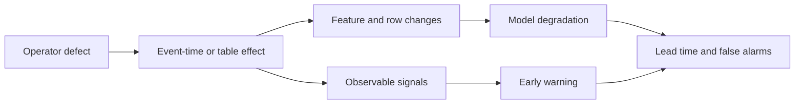

# Research context

This document records why the project exists, what is already published, and what is not claimed. Update it as the literature review grows.

## 1. Problem

Production ML pipelines fail silently. A join duplicates rows, a dimension arrives late, a watermark discards events, or a schema change coerces a type. The job succeeds and the model degrades without an alarm. The delay between cause and observable damage is the core difficulty: labels arrive late, dashboards monitor infrastructure rather than semantics, and engineers cannot tell which pipeline component is responsible.

## 2. Motivation

- Data Cascades reports 92% prevalence of compounding data issues in high-stakes AI, with delayed and invisible effects (Sambasivan et al., CHI 2021, DOI 10.1145/3411764.3445518).
- Observability for production ML is an explicit open agenda: detect, diagnose, react, under missing real-time labels (Shankar & Parameswaran, PVLDB 2022, DOI 10.14778/3565838.3565853).
- Practitioners still operationalize ML by intuition and post-hoc debugging (Shankar et al., CSCW 2024, DOI 10.1145/3653697).
- The data-management community treats error propagation through pipeline steps as an open challenge (Karlaš, Salimi, Schelter, SIGMOD Companion 2025, DOI 10.1145/3722212.3725636).

## 3. What is already closed

| Area | Closest work | Status |
|---|---|---|
| Dataset-level DQ to ML performance | Mohammed et al., Information Systems 2025, DOI 10.1016/j.is.2025.102549 | Closed for single defects on static tables |
| Co-occurring DQ issues | Dapaah & Grabowski, arXiv:2512.17460 (preprint) | Partially open; only software defect prediction |
| Data leakage | Kapoor & Narayanan, Patterns 2023, DOI 10.1016/j.patter.2023.100804; Yang et al., ASE 2022, DOI 10.1145/3551349.3556918; Mishra et al., PLOS ONE 2026, DOI 10.1371/journal.pone.0340167 | Closed |
| Concept drift benchmarks | Wild-Time, NeurIPS 2022; Lukats et al., IJDSA 2024, DOI 10.1007/s41060-024-00620-y | Closed |
| Feature freshness | RALF, PVLDB 17 (2023), DOI 10.14778/3632093.3632116; FeSAIL, IJCAI 2023, DOI 10.24963/ijcai.2023/261; KDD 2026, DOI 10.1145/3770855.3818354; arXiv:2610.02259 | Closing fast |
| Lakehouse compaction | AutoComp, SIGMOD Companion 2025; arXiv:2608.08639 | Closed, with a near-negative result |
| Carbon-aware scheduling | EuroSys 2024, DOI 10.1145/3627703.3650079; SIGCOMM 2025; LinTS, IEEE CLOUD 2025 | Closed, with a negative result |
| Cluster failure prediction | FiCloud 2023; Computing 2026, DOI 10.1007/s00607-026-01718-w | Closed and compute-heavy |
| Time-series anomaly detection | Wu & Keogh, IEEE TKDE 2023, DOI 10.1109/TKDE.2021.3112126; Baldán et al., Expert Systems 2025 | Closed |
| Backfill and data revisions | Back2Future, ICLR 2022, arXiv:2106.04420 | Open but narrow |

## 4. The gap

Existing work injects errors at the dataset level into static tables, or studies one operator in isolation, usually freshness. Three things are missing together:

1. **Operator-level defects** tied to pipeline semantics: joins, watermarks, SCD versions, schema coercion.
2. **Compounding interactions** measured under controlled severity in a streaming setting.
3. **Lead time**: whether cheap observability metadata predicts damage before labels arrive, evaluated against label-free accuracy estimators.

The gap is a measurement gap first. The law is what turns the measurement into a predictive claim.

## 4b. From measurement to a law

A measurement table says defects differ. A law says why, and predicts the next one. The upgrade is a low-dimensional representation of what a defect does to the data and to the model:

- **alpha, decision displacement:** fraction of matched rows present in both the clean and defect runs whose model prediction moves by more than a fixed tolerance. This is the damage the model actually experiences.
- **beta, distribution displacement:** maximum normalized monitor statistic over features and monitor families, `max min(1, statistic / frozen_threshold)`, using PSI and KS. This is what standard drift monitors can see.
- **gamma, coverage displacement:** relative change in retained row count, `|N_defect - N_clean| / N_clean`, clipped to one. This is what volume checks can see.

None of the eight defects corrupts labels directly. They corrupt features, rows, or coverage. That is why alpha must be defined on model outputs, not on labels: an earlier label-corruption definition would be zero for every condition in the taxonomy.

Two falsifiable claims follow.

**Damage law.** Relative degradation is a low-dimensional function of the corruption vector, dominated by alpha and gamma, and largely independent of defect identity and dataset. Fit on one domain, predict held-out defects and held-out datasets. The law must beat a per-defect lookup table. If defect identity adds predictive power, the law is incomplete and must say so.

**Detectability law.** Monitors observe beta and gamma, never alpha. Define the silence index `s = alpha / (alpha + beta + gamma)`, with each component scaled to `[0, 1]`. Predict that alarm recall falls and lead time shrinks as `s` rises, with little useful warning for alpha-dominant defects until labels arrive. "Silent" becomes a measurable property of a condition, not a label attached to a defect.

This turns the study from "defects differ" into "here is the low-dimensional reason they differ, and here is what you can and cannot monitor." The law is explanatory: alpha, beta, and gamma are computed from paired clean and corrupted runs with injector ground truth. An operational predictor must estimate them from observability signals, and that gap is an explicit limitation.

## 5. Contributions

1. An 8-defect taxonomy mapped to pipeline operators, with injection mechanics, expected symptoms, and a corruption-space annotation (alpha, beta, gamma) per condition.
2. A reproducible harness with a deterministic event-time simulator and a config-driven injector.
3. A measurement study of single and compounding defects across three real domains: transport (TLC), media/recommendation (MovieLens 32M), and retail (Online Retail II).
4. A damage law: a low-dimensional predictive model of relative degradation from the corruption vector, tested by transfer to held-out defects and datasets against a per-defect lookup table.
5. A detectability law: the silence index predicts alarm recall and lead time, is evaluated against ATC and static thresholds, and is reported with MAE, lead time, and false-alarm rate.
6. An open artifact: code, configs, run results, and a reproducibility package.

## 6. What is not claimed

- Not a new algorithm. The predictor is gradient boosting on engineered signals.
- Not a production monitor. The harness is an experimental instrument.
- Not a claim that observability beats labels in general. It tests specific defects under specific conditions.
- Not a claim of universal defect coverage. Eight defects, three real domains.
- Not a claim that the taxonomy is complete. It covers common operators, not every failure mode.
- **Not a formal proof.** The damage law is an empirical model fitted on controlled injections, with explicit domain limits. A failure to collapse onto the corruption vector is a reportable result, not a reason to hide the model.
- **Not a claim that alpha is directly observable in production.** The law computes alpha from paired clean and corrupted predictions, an oracle that is unavailable during deployment. The operational predictor estimates it from metadata and confidence signals and must report that estimation error separately.

## 7. Adjacent work to cite and differentiate

| Work | What it does | Why it is not this project |
|---|---|---|
| Mohammed et al. 2025 | Six DQ dimensions, 19 algorithms, 10 tabular datasets | Dataset-level, static, single defects, no lead time |
| Dapaah & Grabowski 2025 | Co-occurring DQ issues in software defect prediction | SDP domain, DQ dimensions, no pipeline operators |
| FIUL-Data, ECBS 2023, DOI 10.1007/978-3-031-49252-5_5; arXiv:2309.11274 | Fault injection for ML data suitability | One mutator at a time, analytical chemistry, no compounding |
| dpEmu, ISSRE Workshops 2019, DOI 10.1109/ISSREW.2019.00087 | Data fault emulation for ML systems | Single faults, no lead-time evaluation |
| RALF, PVLDB 2024 | Feature store maintenance under budget | Freshness only, scheduling focus |
| Garg et al., ICLR 2022, arXiv:2201.04234 | ATC for label-free OOD accuracy | No pipeline metadata, no diagnosis |
| Karlaš, Salimi, Schelter, SIGMOD Companion 2025, DOI 10.1145/3722212.3725636 | Tutorial on data errors across pipeline stages | No controlled benchmark, no lead-time evaluation |
| Shankar & Parameswaran 2022 | Observability vision | No benchmark |

## 7b. Recent adjacent work to differentiate (2026)

| Work | What it does | Why it is not this project |
|---|---|---|
| SUNSET, arXiv:2601.13732 | ROS2 sensor-fusion fault injection with concurrent defects and reproducibility docs | Hardware/sensor focus, no compounding interaction metrics or lead time |
| SARC-DQ, arXiv:2607.26313 | Metadata-borne (freshness/lineage/provenance) defects | No operator taxonomy or streaming lead-time evaluation |
| VisAudit, arXiv:2610.02399 | Controlled perturbation + verification QC for benchmarks | Chart-flaw domain, not pipelines |
| Liang 2026, arXiv:2610.02397 | Seeded, hash-logged defects, SHA-256 pins, prevalence calibrated to field studies | Single-defect focus, no compounding |
| MARGoS, arXiv:2610.13772 | Config hashing, seed propagation, frozen configs, env fingerprinting | Infrastructure, not a study |

## 8. Open questions to resolve during the build

- Does the severity definition transfer across defects, or does each defect need its own scale?
- Do the eight defects collapse onto one damage curve in (alpha, beta, gamma) space, or does interaction require extra terms?
- Does the silence index rank conditions by lead time within a dataset, across datasets, and for unseen defects?
- Can alpha be estimated well enough from metadata proxies to keep the predictor useful without labels?
- Does join topology (star versus snowflake, one-to-one versus one-to-many) change the interaction magnitude?
- Is the 90-day label window in Online Retail II stable across the 2011 test period, or does right-censoring bias the last quarter?
- Does MovieLens popularity drift across the 2022 validation and 2023 test periods make the as-of user and movie aggregates unstable, and does that instability differ by genre or release year?
- Are interaction effects stable across datasets, or domain-specific?
- Does operator-aware metadata beat generic drift signals on silent defects only, or also on volume defects?
- How much does the event-time simulator diverge from Spark Structured Streaming?
- Is the predictor useful at the batch granularity a real team would use?

## 9. Evidence standard

- Prefer peer-reviewed sources. Mark preprints explicitly.
- Record DOI or URL for every citation.
- Do not quote a number from an abstract without checking the full text.
- Keep a literature matrix with columns: claim, method, dataset, metric, limitation, threat to this project. The verified matrix is `docs/litmatrix.md`; update it when a source is added or corrected.

## 10. Contribution claim

PipeFault should not claim that data quality, fault injection, or ML
observability is new. Existing work already covers static data-quality impact,
fault injection, production observability, feature freshness, pipeline
debugging, and label-free accuracy estimation.

The headline claim is the law: operator-level defects can be represented by a
small corruption vector (alpha, beta, gamma), and that vector predicts both how
much a model degrades and whether standard monitors can see it before labels
arrive. The measurement study is the evidence base. The harness is the
instrument.

The supporting claim is narrower: this is the first controlled comparison that
combines operator-level defects, event-time semantics, compounding treatments,
delayed labels, and early-warning evaluation on real tabular pipelines. If the
law fails to collapse, the supporting claim still stands on its own as a
benchmark contribution.

## 11. Research-first decision rule

Every proposed component must answer one of these questions:

1. Does it make a defect mechanism more realistic?
2. Does it improve causal measurement or reproducibility?
3. Does it test detection, diagnosis, or generalization?

If it answers none of them, defer it. Spark, Redpanda, FastAPI, Streamlit,
and neural models are optional extensions, not evidence of contribution.
