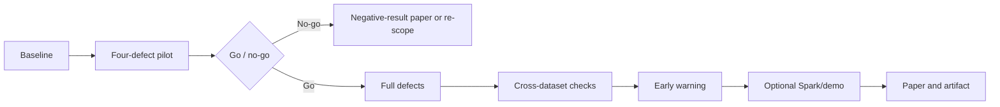

# Roadmap

Twelve weeks plus four weeks of buffer. Each week has one primary deliverable and a testable success criterion. Do not start the next week until the current criterion passes or a deviation is recorded.

## 1. Weekly plan

| Week | Tasks | Deliverable | Success criteria | Tag |
|---|---|---|---|---|
| 0 | Repo scaffold, literature matrix, environment, three datasets, natural-defect audit | `docs/litmatrix.md`, `make data`, `make audit` | 30 verified papers with DOIs; three downloads reproducibly hashed; natural defect rates recorded | `v0.0-scaffold` |
| 1 | TLC ETA baseline, time split, leakage checklist | Baseline notebook and `pipefault baseline` | RMSE stable across seeds; leakage checks pass; no post-pickup features | `v0.1-baseline` |
| 2 | Injector v1: D1, D5, D6 with tests | `pipefault/inject/` | Deterministic; exact affected counts; 20 tests pass | `v0.2-injector` |
| 3 | Full 8-defect taxonomy, TLC 40-condition pilot, MLflow, **go/no-go** | Experiment runner, pilot report | 2 models x 4 defects x 5 severities complete; median degradation at least 2% or re-scope | `v0.3-pilot` |
| 4 | Olist and Online Retail II pipelines, cross-dataset check | Three domains, leakage report | Joins correct; label windows covered by embargoes; no opposite-signed surprise left unexplained | `v0.4-datasets` |
| 5 | Compounding: 28 pairs, 5 triples, statistics | Interaction table and heatmap | CIs computed; at least 3 pairs with CI excluding zero, or documented null | `v0.5-interactions` |
| 6 | Observability module, 30 signals, drift and confidence | `pipefault/observe/` | Signals computed per batch; invariant tests; no future data | `v0.6-signals` |
| 7 | Early-warning predictor, ATC and static baselines | Model and evaluation | MAE, R2, lead time, false-alarm table; first ablation | `v0.7-predictor` |
| 8 | Redpanda and Spark validation on 3 conditions | Validation report | At least 99% row-level agreement; latency measured | `v0.8-validation` |
| 9 | FastAPI, Streamlit, Docker Compose | Demo | `docker compose up` works; dashboard shows defect, predicted degradation, lead time | `v1.0-demo` |
| 10 | Final grid, ablations, figures | Results bundle | All conditions complete; every figure generated from configs | `v1.1-results` |
| 11 | Paper draft v1 | `paper/main.tex` | Every claim backed by a result; all references verified | `paper-v1` |
| 12 | Internal review, artifact, Zenodo DOI, arXiv, submission prep | Submission package | Reproducibility check on a clean machine passes | `v1.2-submission` |
| 13–16 | Buffer, journal extension, rebuttals | Extended draft | Additional dataset or analysis | optional |

## 2. Go/no-go at week 3

Run 4 defects (D1 volume, D5 volume, D3 silent, D6 silent) x 5 severities x 2 models = 40 conditions.

- **Go:** median relative degradation is at least 2% for most conditions, and at least one silent defect is invisible to PSI/KS at the frozen threshold.
- **Re-scope:** if degradation is flat, reframe as a negative-result measurement paper, drop to the minimum grid, or switch to SchemaMiner.
- **Do not:** continue building the full harness on hope.

## 3. Kill criteria

| Trigger | Action |
|---|---|
| Week 3 pilot is flat | Re-scope, drop to minimum grid, or switch project |
| Week 4 cross-dataset check shows opposite-signed effects | Report as domain dependence; do not pool without an interaction term |
| Week 6 signals require future data | Redesign signals; do not proceed |
| Week 8 simulator agreement below 99% | Drop the streaming claim; report as micro-batch simulator |
| Week 10 full grid incomplete | Drop to the primary or minimum tier; keep the core comparison |
| Week 11 no result supports H1–H3 | Write the negative-result paper; do not fabricate |

## 4. Weekly checklist

- [ ] Deliverable committed and tagged.
- [ ] Tests pass in CI.
- [ ] Experiment configs hashed and recorded.
- [ ] Results table updated, including nulls.
- [ ] Deviations logged in `docs/PREREGISTRATION.md`.
- [ ] One paragraph added to the paper draft or lab notebook.

## 5. Definition of done

- `make data`, `make audit`, `make baseline`, `make pilot`, `make experiment`, `make reproduce`, `make demo` all work from a clean clone.
- The full grid is reproducible within numerical tolerance.
- Every figure is generated from a config, not hand-edited.
- The paper draft cites only verified sources.
- The artifact has a DOI and a README that a stranger can follow.
- The model card documents intended use and limitations.

## 6. Buffer plan

Weeks 13–16 are not free time. Use them for:

1. A fourth real dataset (UCI Bike Sharing) if reviewers ask for external validity beyond transport, marketplace, and retail.
2. A journal extension with a deeper related-work section.
3. Rebuttals and camera-ready preparation.
4. A public demo deployment on a free tier with aggregated data only.

If everything finishes early, stop. Do not add scope to look impressive.

## 7. Revised priority rule

The roadmap is evidence-first. Weeks 2-7 are the core research program; weeks
8-12 are validation, packaging, and publication support. A later technology
milestone cannot compensate for a missing experiment or an unverified claim.

The first release is complete when the TLC pilot is reproducible, statistically
reported, and interpretable on the local machine. The dashboard, API, Redpanda,
MLP, and full experiment grid remain optional until that condition is met.
